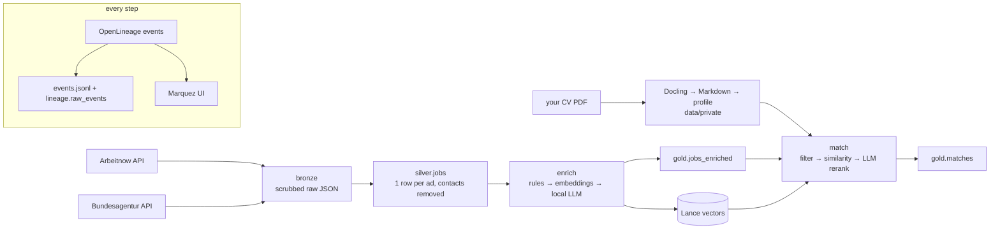

# traceable-jobradar-poc · jobradar

A small, fully open-source AI data pipeline you can run on a laptop: it collects last week's job ads from two
public German/EU APIs, uses **local models** to classify them and extract facts (German required? remote? salary?
visa sponsorship? contract type?), and matches them against **your CV**, which never leaves your machine.

Every step emits **OpenLineage** events, every table is plain **Delta Lake**, and governance is built in rather
than bolted on: data contracts, retention, privacy scrubbing, a lineage-driven erasure command and an exit test.

It is the companion demo for the talk *"Who Owns Your AI Data Pipeline?"* (SFSCON 2026).

> Proof of concept. Not a production job tool, and not affiliated with Arbeitnow or the Bundesagentur für Arbeit.

## What it shows

| Talk idea | Where it lives here |
|---|---|
| Open formats, no lock-in | Delta tables (delta-rs) and Lance vectors; `jobradar exit-test` reads them with DuckDB's own reader |
| Lineage past the model | OpenLineage events for ingest, enrich, CV load, match, retention and erasure, with table versions and custom facets for model, prompt version and CV hash |
| The model hop is swappable | Any OpenAI-compatible endpoint, chosen by env vars; every output records which model made it |
| Sovereignty | Defaults run locally (Ollama on your Mac); lineage flags `runs_locally` for every model call |
| Data contracts | ODCS v3 contracts in `contracts/`, checked in CI |
| GDPR in the pipeline | Contact data scrubbed at ingest (minimisation), 7-day retention with vacuum, `jobradar erase` finds everything derived from your CV by following lineage |
| Explainable extraction | `field_sources` says whether each value came from the source API, a rule, embeddings or the LLM |

## Architecture



Retention deletes ads older than 7 days from every table and the vector store. Erasure follows the lineage
log from your CV hash to every dataset derived from it.

## Quick start (macOS, Apple Silicon)

Requirements: Python 3.11+ (macOS ships 3.9: `brew install python@3.12`), [Ollama](https://ollama.com),
Docker Desktop (only for the Marquez UI). `make install` finds the newest Python 3.11+ on your PATH,
or use `make install PYTHON=/path/to/python3.12`.

```bash
git clone https://github.com/sammcruz/traceable-jobradar-poc && cd traceable-jobradar-poc
make install && source .venv/bin/activate     # creates .venv (Python 3.11+) and .env

# 1. See it work offline first: sample data, fake models, no network
make demo

# 2. Real data with local models
brew install ollama && ollama serve &          # or install the Ollama app
make models                                    # qwen3:8b + bge-m3 (~6 GB)
make lineage-up                                # Marquez UI at http://localhost:3000
make run                                       # ingest last 7 days, enrich, LLM on tech ads
jobradar cv load ~/Documents/my-cv.pdf
jobradar match --no-german --remote remote --remote hybrid
jobradar app                                   # local web page at http://localhost:8501
```

A first `make run` takes a while: embeddings for all ads are quick, but the LLM step takes a few seconds per ad,
so it is limited to tech categories and 200 ads by default. Results are cached by content hash.

## Commands

| Command | What it does |
|---|---|
| `jobradar ingest` | Fetch ads from the last 7 days (config/sources.yml), scrub contact data, apply retention |
| `jobradar enrich [--deep -c data --limit 100]` | Category, German, remote, salary, visa, contract, seniority, skills |
| `jobradar stats` | Counts per category |
| `jobradar cv load FILE` | PDF/Markdown → Markdown → profile (no name or contact data) → vector |
| `jobradar match [filters]` | `--no-german --remote remote --salary --visa --contract permanent --seniority senior -c data` |
| `jobradar app` | Streamlit page: match, explore, lineage, privacy |
| `jobradar erase` | Delete your CV and everything derived from it, found through lineage |
| `jobradar retention` | Re-apply the retention window |
| `jobradar check-contracts` | Check tables against ODCS contracts |
| `jobradar exit-test` | Read every table with DuckDB's Delta extension |
| `jobradar lineage show` / `sync` | Recent runs / copy the event log into a Delta table you own |

## Swapping the model

Edit `.env`:

```bash
LLM_MODEL=mistral-small3.2      # another Apache 2.0 model in Ollama (~15 GB, needs 32 GB RAM)
EMBED_MODEL=bge-m3
LLM_BASE_URL=http://localhost:11434/v1   # or vLLM, LiteLLM, any OpenAI-compatible endpoint
```

Re-run `jobradar enrich --deep`: the new model name and prompt version land in lineage and in each row.
If you point `LLM_BASE_URL` at a hosted API, the app and lineage will show that prompts leave your machine.

## Components and licenses

| Component | License | Role |
|---|---|---|
| [OpenLineage](https://openlineage.io) spec / [Marquez](https://marquezproject.ai) | Apache 2.0 | Lineage events / lineage UI |
| [delta-rs](https://github.com/delta-io/delta-rs) | Apache 2.0 | Delta Lake tables |
| [DuckDB](https://duckdb.org) | MIT | SQL and exit test |
| [LanceDB](https://lancedb.com) | Apache 2.0 | Vector store |
| [Docling](https://github.com/docling-project/docling) | MIT | PDF → Markdown |
| [Ollama](https://ollama.com) | MIT | Local model runtime |
| Qwen3 8B (default LLM) | Apache 2.0 | Extraction, CV profile, rerank |
| BGE-M3 (default embeddings) | MIT | Multilingual embeddings (most ads are German) |
| [Streamlit](https://streamlit.io) | Apache 2.0 | Local web page |

Model licenses are per model variant. Check the license of the exact model you pull before you rely on it.

## Data sources and terms

- **Arbeitnow job-board API**: public, no key ([docs](https://www.arbeitnow.com/blog/job-board-api)).
- **Bundesagentur für Arbeit job search API**: public; the `X-API-Key: jobboerse-jobsuche` header is the
  documented public client id. Searched by the keywords in `config/sources.yml`, last 7 days only.

Read each source's terms before publishing anything derived from the ads. This repository contains code and
**invented** sample data only (`tests/fixtures/`); real ads and your CV stay in `data/`, which is git-ignored.

## Privacy by design

- Ingest drops personal keys (contact persons, addresses, phone, e-mail) from raw payloads and redacts them from
  ad text. Redaction is pattern-based and can miss unusual formats.
- Your CV is converted locally, redacted, and reduced to a profile without name or contact details.
  Lineage stores only its hash.
- `jobradar erase` deletes CV files and match rows, then vacuums Delta files so time travel cannot bring them back.

## Known limitations

- The live APIs were not reachable from the environment this was built in; parsing is written against their
  documented formats and tested with invented responses. Expect small fixes on the first live run.
- Extraction rules are tuned for German and English ads; the LLM fills gaps but can be wrong. Check
  `field_sources` before trusting a value.
- No authentication: the web page is meant for localhost only.

## License

Apache 2.0. See [LICENSE](LICENSE).
